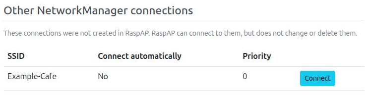
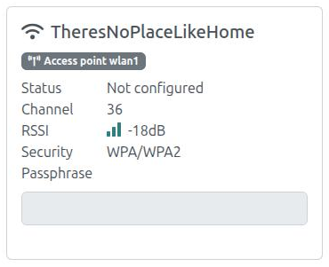
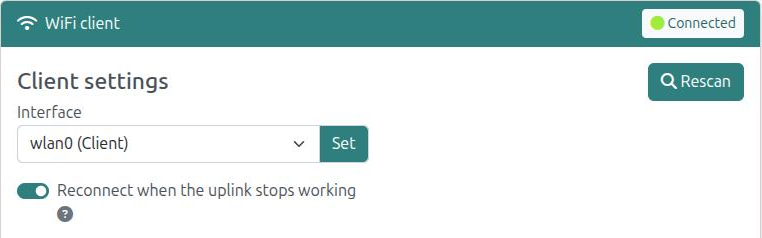

# WiFi client

## Overview
The **WiFi client** page connects your device as a client, or station, to an existing wireless network. This network is often the uplink that gives your access point its internet connection, for example the WiFi of a hotel when you use RaspAP as a travel router. A setup with this kind of uplink is described in [Wireless LAN routing](wlanrouting.md).

Select the client interface under **Interface** and choose **Set**. Then choose **Rescan** to search for nearby networks. The page shows each network as a card with its SSID, channel, signal strength (RSSI) and security. Networks that are saved in RaspAP are shown under **Known**, other networks under **Nearby**.

- To save a network, enter its passphrase and choose **Add**.
- To change the passphrase of a saved network, choose **Update**.
- To connect to a saved network, choose **Connect**. **Disconnect** ends the connection.
- To remove a saved network, choose **Delete**.

!!! note "Note"
    WEP access points appear as "Open". RaspAP does not support connections to WEP networks. See the [FAQ](../faq.md#wep) for a workaround.

## NetworkManager
Recent versions of Raspberry Pi OS use NetworkManager to manage the network interfaces. RaspAP finds out which program manages the client interface each time the page loads:

- When NetworkManager runs and manages the client interface, RaspAP creates a NetworkManager connection for each saved network. NetworkManager then connects the interface.
- When NetworkManager does not manage the client interface, RaspAP uses `wpa_supplicant` and `wpa_cli`, as in earlier versions.

In both cases, RaspAP keeps its saved networks in `/etc/wpa_supplicant/wpa_supplicant.conf`. When NetworkManager manages the interface, each save also updates the NetworkManager connections, so that they match this file. The connections are stored as `/etc/NetworkManager/system-connections/raspap-wifi-<hash>.nmconnection`. They connect automatically, so the device connects to a saved network again after a reboot.

When you save the hotspot settings, RaspAP removes its connections from the AP interface. When you change the client interface, it removes them from the old client interface. Connections that RaspAP did not create do not change.

### Other NetworkManager connections
NetworkManager can also have WiFi connections that RaspAP did not create, for example the connection `preconfigured` from Raspberry Pi Imager, or a connection that you made with `nmcli`. The page shows these connections in the section **Other NetworkManager connections**, with their priority and the **Connect automatically** setting. You can connect to them with **Connect**. RaspAP does not change or delete them.

If one of these connections is for the same network as a saved RaspAP network, it shows the hint **Same network as a RaspAP network**.

{: style="width:560px"}

### Limitations
- RaspAP gives NetworkManager the 64-digit PSK of each network. It makes the PSK from the saved passphrase, which must have 8 to 63 printable ASCII characters. If a saved network has no passphrase that RaspAP can use, the page shows a warning. Enter the passphrase again and choose **Update**.
- Networks that support only WPA3 (SAE) are not supported. Networks in WPA2/WPA3 transition mode connect with WPA2.

## Own hotspot
When the device scans for networks, it also finds its own access point. The page marks this network with an **Access point** badge and the name of the AP interface. A connection of the client to the hotspot of the same device is never useful, so the card disables the passphrase field and has no **Add** button. If the network is already saved, for example from an older configuration, **Update** and **Connect** are disabled. **Delete** stays available.

{: style="width:300px"}

When an access point of a different device sends the same SSID, the card shows a note that the network is also the hotspot of this device. You can then still save and connect to the network, and the page shows a warning. The client connects by SSID, so it can also select the access point of this device.

There is no setting for this mark.

## Uplink watchdog
Sometimes the WiFi client stays connected to the uplink network, but the network does not forward traffic any more. This can occur with some hotel and public networks. The uplink watchdog finds this condition and connects the client to the network again.

To turn it on, enable **Reconnect when the uplink stops working** on the WiFi client page. The watchdog is off by default. If the watchdog is not installed, the switch is not shown.

{: style="width:560px"}

A systemd timer (`raspap-uplink-watchdog.timer`) runs a check every 30 seconds:

1. The watchdog uses the interface of the first default route. It does nothing when this interface is the AP interface, when it is not a WiFi interface, or when it is not connected.
2. It pings the gateway through this interface. If the gateway does not reply, it checks the ARP entry of the gateway. A ping that is blocked does not count as a failure while the gateway answers ARP.
3. After 3 failures in a series (approximately 90 seconds), it connects the client to the network again. With NetworkManager it activates the current connection again. Without NetworkManager it uses `wpa_cli reassociate` and then `dhcpcd`.
4. It connects again at most one time in 10 minutes.

The watchdog changes only the uplink. It does not change the access point, a VPN tunnel or the firewall. When the watchdog is on, the page shows the time of the last reconnect below the switch. Each change is written to the system log. To see it, execute `sudo journalctl -t raspap-uplink-watchdog`.

!!! note "Limitations"
    * The watchdog checks IPv4 only, and only the first default route.
    * It does not find an access point that answers ARP but does not forward traffic.

## Discussions
Questions or comments about the WiFi client? Join the [discussion here](https://github.com/RaspAP/raspap-webgui/discussions/).
