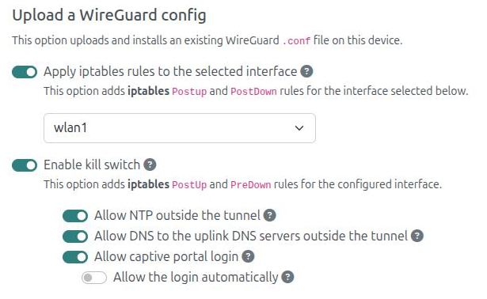

# WireGuard

{: style="width:640px"}

## Overview
WireGuard<sup>®</sup> is an extremely simple yet fast and modern VPN that utilizes state-of-the-art cryptography. It aims to be considerably more performant than OpenVPN,
and is generally regarded as the most secure, easiest to use, and simplest VPN solution for modern Linux distributions.

WireGuard may be optionally installed by the [Quick Installer](../get-started/quick-installer.md). Once this is done, you can manage both local and remote server settings, create a peer configuration and control the `wg-quick` service with RaspAP.

## Securing your wireless network
RaspAP gives you two ways to create a secure WireGuard tunnel: **1)** by uploading a `.conf` file from your VPN provider, or **2)** by creating a manual configuration. Each method is described and demonstrated with a short video below.

### File upload
This method may be used if you are using a commerical WireGuard VPN provider, a self-hosted or other remote WG server. In these cases, it's assumed you have an existing WireGuard `.conf` file and wish
to upload this to RaspAP.

!!! note "Note"
    The term "server" is used here as a convenience. WireGuard does not make a distinction between client and server roles. Instead, each node is considered a "peer" in a WireGuard network.

To do this, select the **Upload file** option under **Configuration Method**, select a valid WireGuard configuration file and choose **Save settings**. If your `.conf`
file does not contain `iptables` `PostUp` or `PostDown` rules and you wish to route traffic through the active AP interface, select the **Apply iptables rules for AP interface** option before uploading your
configuration file.

!!! warning "Attention"
    For security reasons, your WireGuard `.conf` file must have a Linux MIME type of `text/plain`. Windows ignores MIME types, relying instead on extensions. To avoid errors, be sure your file has a `text/plain` MIME type embedded in it before uploading.

The complete process of creating a WireGuard configuration with [Mullvad](https://mullvad.net/) and activating it with RaspAP is demonstrated in the video below. 

<video src="https://user-images.githubusercontent.com/229399/128004140-1b006c5a-d758-4cbd-b051-48182c846fbc.mov" data-canonical-src="https://user-images.githubusercontent.com/229399/128004140-1b006c5a-d758-4cbd-b051-48182c846fbc.mov" controls="controls" muted="muted"></video>

It should be noted that RaspAP has no affiliation whatsoever with Mullvad. In fact, Mullvad [does not use affiliates](https://mullvad.net/en/help/policy-reviews-advertising-and-affiliates/) or pay for reviews.

#### Starting WireGuard
RaspAP will handle uploading your `.conf` file and, optionally, applying any `iptables` rules. To enable the tunnel, choose **Start WireGuard**. The WireGuard protocol is extremely fast, so in most cases
your new public IPv4 address will be indicated almost immediately. Click or tap the :octicons-link-external-16: icon to open a new window with details about your public IP.

#### Verifying client connections
If you have chosen to route traffic from the `wg0` interface to the AP interface, you may verify that your clients are secured by the WireGuard VPN. Start by connecting a client to your AP while
WireGuard is enabled. Again, using Mullvad as an example, visit their [connection check](https://mullvad.net/en/check/) page on your client device. If the tunnel is working correctly, you should see
a result like the following: 

{: style="width:300px"}

If any of the above checks fail, enable WireGuard service logging in RaspAP and check the output. You may also consult your VPN provider's support. 

#### IPv6 considerations
RaspAP currently handles routing of IPv4 traffic only. For this reason, WireGuard server connections and traffic tunneled on IPv6 are incompatible. The solution is to specify IPv4 in your
WireGuard VPN provider's advanced options (Mullvad is shown below): 


{: style="width:375px"}

Alternatively, open your `.conf` file in a text editor and ensure that the `Address` and `AllowedIPs` settings use IPv4 addresses only, like so:

```
[Interface]
PrivateKey = ░░░░░░░░░░░░░░░░░░░░░░░░░
Address = 10.64.171.100/32
DNS = 193.138.218.74

[Peer]
PublicKey = /pS3lXg1jTJ7I58GD/s/4GNL2B0U8JNbjbH9Ddh0myw=
AllowedIPs = 0.0.0.0/0
Endpoint = 185.254.75.3:51820
```

When this is done, you are ready to upload your configuration to RaspAP. 

### Manual configuration
Alternatively, RaspAP gives you full control over creating a manual WireGuard configuration. This method is useful if you wish to secure your local wireless network&#151;that is, between your
device running RaspAP and the clients connected to it.

WireGuard requires a public and private keypair for each device you wish to have access to the VPN tunnel. RaspAP simplifies this process with a
magic button :fontawesome-solid-wand-magic-sparkles: associated with each public key input field. Simply click or tap this button to securely generate a cryptographic keypair for both the server and peer.

Several [default values](../get-started/defaults.md) are provided for you as a starting point. These are intended to get a VPN tunnel up and running quickly. They may be modified to suit your needs.

After the keypairs are generated, simply choose **Save settings** followed by **Start WireGuard**.

The video walkthrough below illustrates the steps of configuring a WireGuard tunnel from start to finish.

<video width="640" height="480" controls>
  <source src="https://user-images.githubusercontent.com/229399/110525356-c89d1980-8114-11eb-81f5-8cb5558cb664.mov" type="video/mp4">
  Your browser does not support the video tag.
</video>

Due to WireGuard’s design, both computers on either end of the VPN tunnel will need to have each other's public key. This is discussed below.

!!! note "Note"
    For security reasons, the local (server) private key is not displayed in the UI. The peer private key is encoded in the QR code and available to download in the `client.conf` file.

If you wish to regenerate local or peer keypairs (or both), simply tap or click the magic button :fontawesome-solid-wand-magic-sparkles: and choose **Save settings**. Alternatively, to 
remove a server or peer configuration entirely, disable the desired toggle and **Save settings**. This will delete the public/private keypair and the associated configuration.

#### Peer configuration
RaspAP processes the values in the WireGuard **Settings** and **Peer** tabs and creates two configurations for you: `wg0.conf` and `client.conf`.
The former is used to configure the local (server) side of the VPN tunnel. The latter peer configuration is generated as a QR code on the **Peer** tab. Clients such as mobile devices
may scan the QR code to transfer `client.conf` and import it into an associated WireGuard client application.


The peer endpoint address may take the form of an IP address, hostname, or Dynamic DNS (DDNS) URL with the remote UDP port (`31820` is typical).

!!! note "Note"
    For this release, a single peer configuration may be created. The ability to manage multiple peer configurations is on the project roadmap.

Your peer will need to have WireGuard installed as well. For installing WireGuard on other systems, please see Wireguard's [website](https://www.wireguard.com/install/).

## Tunneling traffic
RaspAP uses WireGuard's `PostUp` and `PostDown` firewall rules to forward traffic from the `wg0` interface to your configured wireless interface.
When you upload a configuration with the **Apply iptables rules for AP interface** option, RaspAP adds these lines: 

```
PostUp = /etc/raspap/networking/wg-forward.sh up %i ap
PostDown = /etc/raspap/networking/wg-forward.sh down %i
```

With `ap`, the script reads the current AP interface from `hostapd.conf` each time the tunnel starts. If you select an interface that is not the AP interface, RaspAP writes that interface name instead of `ap`. The script then adds the `FORWARD` and `MASQUERADE` rules for this interface. In the example below, the default AP interface `wlan0` is used: 

```
iptables -A FORWARD -i wlan0 -o wg0 -j ACCEPT
iptables -A FORWARD -i wg0 -o wlan0 -m state --state RELATED,ESTABLISHED -j ACCEPT
iptables -t nat -A  POSTROUTING -o wg0 -j MASQUERADE
```

Because the configuration does not contain the AP interface, you do not need to upload your configuration again when you change the AP interface or the AP subnet later. Restart WireGuard to apply the change.

These lines are defined in WireGuard's [default settings](../get-started/defaults.md) and may be modified if you wish.

!!! note "Note"
    An update of RaspAP migrates the inline `iptables` rules of older configurations to these lines and keeps a backup of the original file as `<name>.forward.bak`. A running tunnel keeps its old rules until it stops.

!!! note "Note"
    If your VPN server is behind a NAT, you will need to open a UDP port of your choosing (51820 is the default). 

## Kill switch
:octicons-beaker-24: Experimental

In the event that the WireGuard tunnel accidentally goes down, unencrypted traffic may reveal your real IP address. To prevent this from happening, additional `PostUp` and `PreDown` rules may be
added to the firewall. Simply choose the **Enable kill switch** option when uploading your WireGuard configuration:

{: style="width:480px"}

These rules are automatically appended to your configuration. They call the kill switch script with the options that you select (see below):

```
PostUp = /etc/raspap/networking/wg-killswitch.sh up %i --allow-ntp
PreDown = /etc/raspap/networking/wg-killswitch.sh down %i
```

The kill switch blocks all internet traffic of the device that does not go through the tunnel, for IPv4 and IPv6. It does not block local traffic: private and link-local networks, broadcast, multicast, DHCP and the AP subnet. Thus you can still open the RaspAP web interface or use SSH from the uplink network while the tunnel is down.

When the tunnel starts, the script reads the current AP interface from `hostapd.conf` and allows the subnet of this interface. If you change the AP interface or the AP subnet later, restart WireGuard; you do not need to upload your configuration again.

!!! note "Note"
    Some VPN providers give you the option of adding these rules to their Linux configurations. Skip this option as RaspAP needs to add an exclusion rule for your AP interface.

### Kill switch options
When you choose **Enable kill switch**, these options are shown below it:

| Option | Default | Script option | Description |
|---|---|---|---|
| **Allow NTP outside the tunnel** | On | `--allow-ntp` | NTP (UDP port 123) goes outside the tunnel, so the device can set its clock while the tunnel is down. A WireGuard handshake fails when the clock is behind. |
| **Allow DNS to the uplink DNS servers outside the tunnel** | Off | `--allow-dns` | DNS requests of the device to the nameservers in `/etc/resolv.conf` go outside the tunnel, so the device can resolve names (for example an NTP server) while the tunnel is down. The DNS requests of AP clients do not change. |
| **Allow captive portal login** | Off | `--allow-portal` | AP clients can log in to a captive portal of the uplink network. See [Captive portal login](#captive-portal-login). |
| **Allow the login automatically** | Off | `--portal-auto` | Shown only when **Allow captive portal login** is on. The login is allowed without a click. |

RaspAP also installs `fake-hwclock`. It saves the time every 5 minutes, and at boot it sets the clock to the last saved time. Together with the NTP option, this lets the tunnel connect after a reboot.

!!! note "Note"
    An update of RaspAP replaces the kill switch rules of older configurations with calls to `wg-killswitch.sh` and keeps a backup of the original file. A migrated configuration gets `--allow-ntp`. A running tunnel keeps its old rules until it restarts.

### Captive portal login
Many public networks, for example in hotels, need a login on a captive portal before they give access to the internet. Until the login, the WireGuard tunnel cannot connect, and the kill switch blocks the login page for your AP clients. The **Allow captive portal login** option lets AP clients log in while the tunnel and the kill switch stay on.

When the option is on, a systemd timer (`raspap-captive-portal.timer`) runs a check every minute:

1. The check pings `1.1.1.1` and `9.9.9.9` through the tunnel. When one of them answers, the tunnel works and nothing else happens.
2. When the pings fail, the check requests `http://detectportal.firefox.com/success.txt` through the uplink. Only the system user `raspap-probe` can send this request; the kill switch allows this user on TCP port 80 only. A redirect, or a login page instead of the expected answer, means that the uplink has a captive portal.
3. The dashboard and the WireGuard page then show a warning with the button **Allow the login for 5 minutes**.

When you click the button, the login is allowed. During this time, the HTTP (TCP port 80) and DNS requests of AP clients go to the uplink network instead of the tunnel. On a device that is connected to the hotspot, open a website that starts with `http://`. The login page of the network then opens. If the portal sent the address of its login page, the warning also shows the link **Open the login page**. HTTPS and all other traffic of AP clients stay blocked, and the kill switch of the device does not change.

The login ends:

- after 5 minutes (at the next check, so at most 1 minute later),
- when the tunnel works again,
- when the uplink is free (after the login), or
- when you click **End the login now**.

The tunnel then connects again without a restart.

With **Allow the login automatically**, the login is allowed without a click when the check finds a captive portal. It then stays allowed until the tunnel works again or the uplink is free.

!!! warning "Attention"
    With **Allow the login automatically**, a network that blocks the tunnel and shows a false login page can see the HTTP and DNS requests of your AP clients until the tunnel works again. Use this option only on networks that you trust. Without it, the HTTP and DNS requests of AP clients go outside the tunnel only after you click the button, and for 5 minutes at most.

!!! note "Limitations"
    * A login page that uses only HTTPS does not work, because TCP port 443 stays blocked.
    * The DNS server of the uplink network must be in a private network (the kill switch allows the private ranges), or you must enable **Allow DNS to the uplink DNS servers outside the tunnel**. Otherwise the check cannot resolve the name of its test address.

The check writes each change to the system log. To see it, execute `sudo journalctl -t raspap-captive-portal`.

## Multiple configs
:octicons-beaker-24: Experimental

RaspAP lets you manage multiple WireGuard configurations. This includes the ability to upload, activate and delete any number of valid wg .conf files. Select the **Apply iptables rules for AP interface** option when uploading your .conf file to automatically route traffic to connected peers on the AP interface.

{: style="width:450px"}

Thereafter, switching between your saved configurations is done by simply activating the desired profile. Activating a profile will restart the `wg-quick` service automatically. Additionally, WireGuard service activity may be tracked on the **Logging** tab.

## Low overhead
Due to its low overhead compared with OpenVPN, WireGuard is well-suited for applications where battery longevity is a concern. As [described by its developer](https://www.wireguard.com/quickstart/#nat-and-firewall-traversal-persistence),
WireGuard isn't a chatty protocol. For the most part, it only transmits data when a peer wishes to send packets. When it's not being asked to send packets, it stops sending packets until it is asked again.

As a result, your wireless adapter has a higher likelihood of being able to idle down, which leads to better battery life.

## Troubleshooting
RaspAP provides a front end to WireGuard only; it makes no attempt to validate `.conf` files uploaded to your device. For this reason, the service may fail to start for a variety of reasons.

!!! tip Tip
    Drop to the shell and execute `sudo systemctl start wg-quick@wg0`. If WireGuard fails to start, expect no different from RaspAP.

In this event, use RaspAP's WireGuard service logging facility or execute `sudo journalctl --identifier wg-quick`. Scan the log for errors and consult the [WireGuard documentation](https://www.wireguard.com/) to ensure that your configuration is valid.

See also the [FAQ section](../faq.md#wireguard) for WireGuard.

## Discussions
Questions or comments about using WireGuard? Join the [discussion here](https://github.com/RaspAP/raspap-webgui/discussions/).

